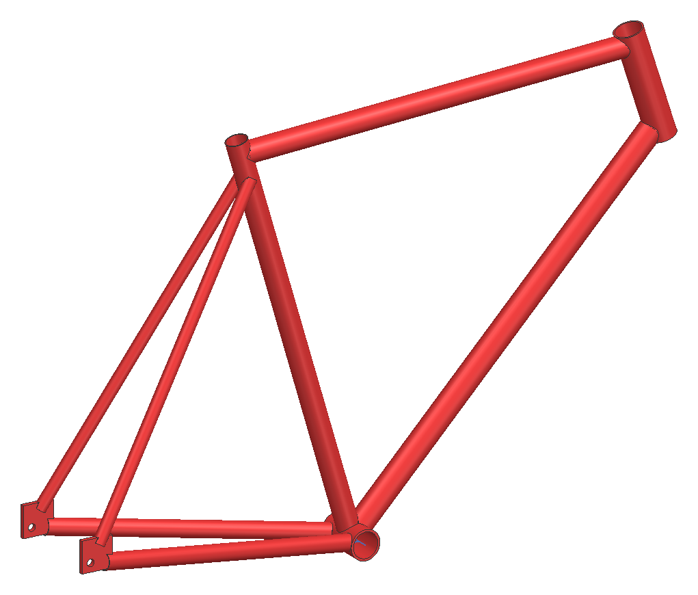
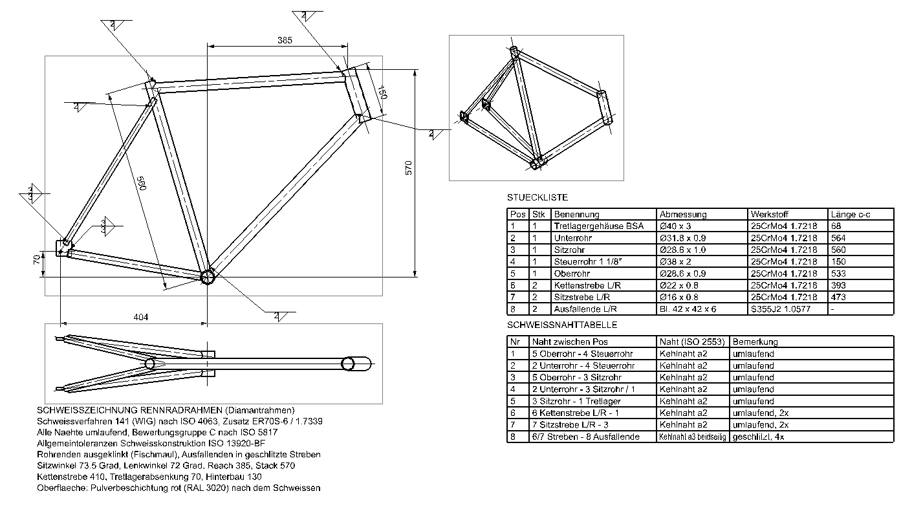
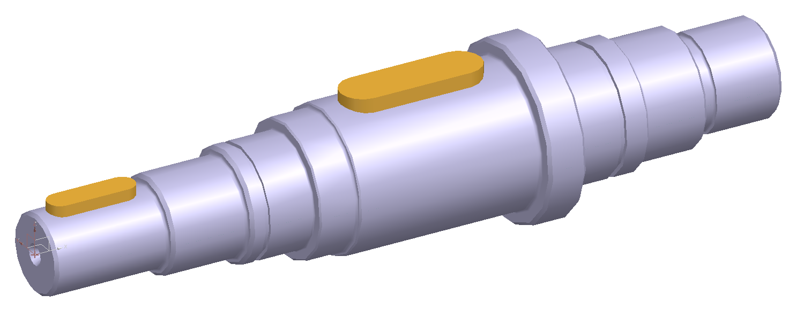
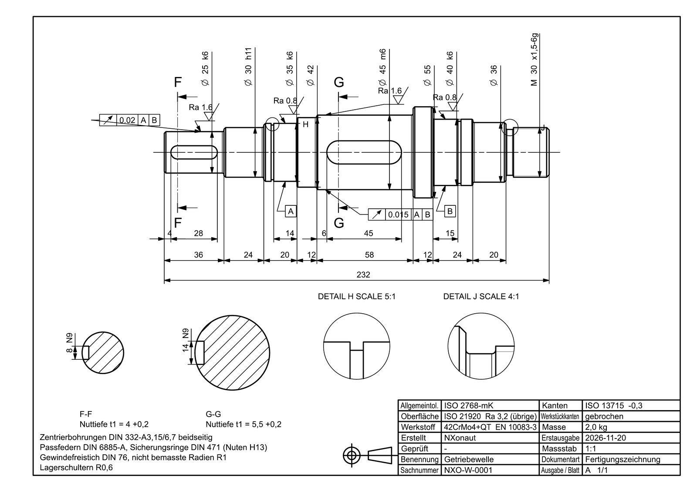
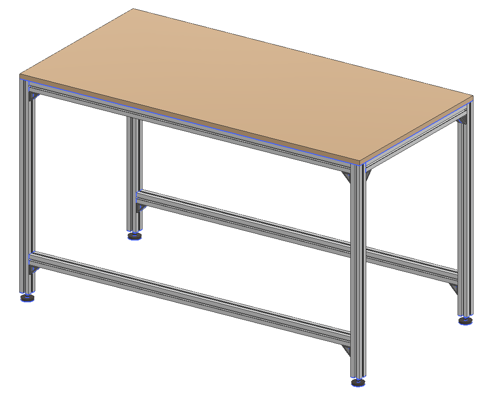
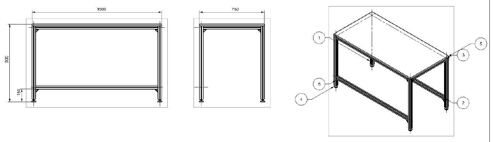
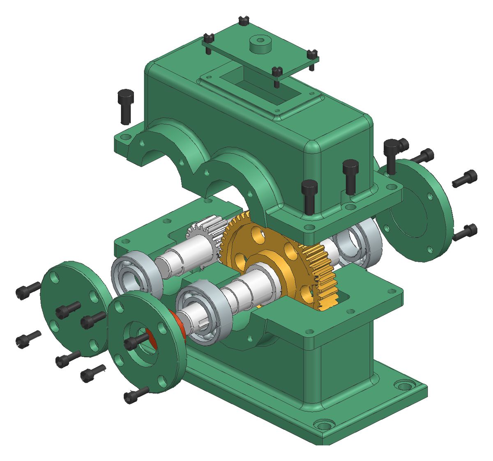
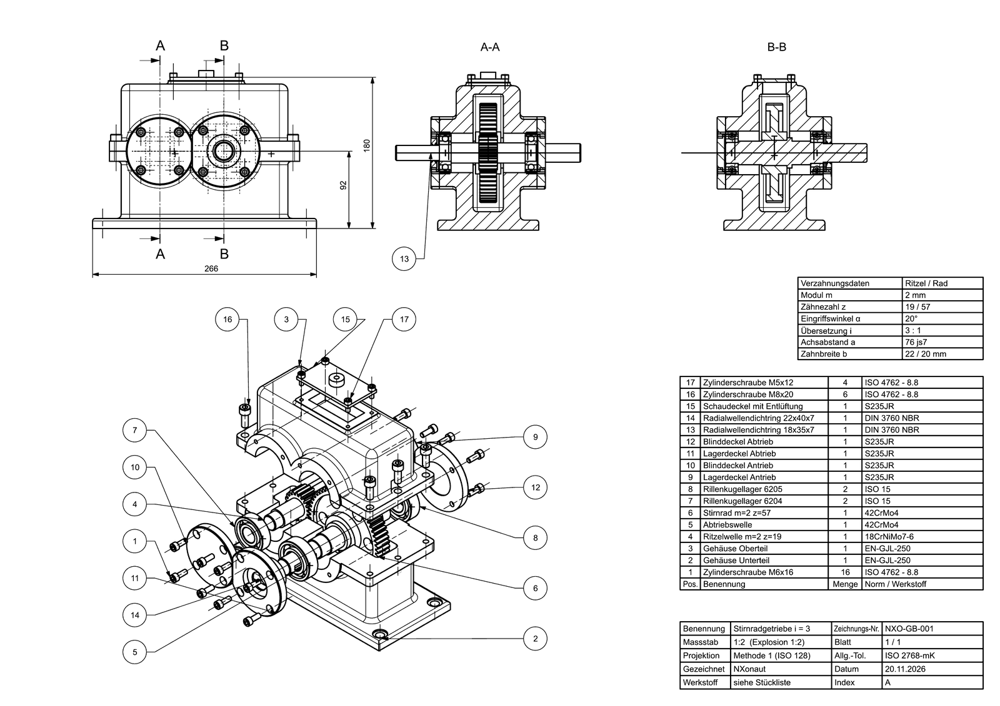

  

# NXonaut

Let Claude work next to you in **Siemens NX**: parts, sketches, assemblies with
constraints, measurements, drawings and STEP export.

NXonaut is built first for **Claude** (Claude Desktop and Claude Code). Other MCP
clients such as Codex or Cursor work too: see the
[manual install](https://michaelhaldimann-png.github.io/NXonaut/install/#manual-install).

**Documentation: [michaelhaldimann-png.github.io/NXonaut](https://michaelhaldimann-png.github.io/NXonaut/)**

## Install and start (Claude Desktop, Windows)

1. Download `nxonaut-<version>.mcpb` from the
   [latest release](https://github.com/MichaelHaldimann-png/NXonaut/releases/latest).
2. Double-click the file and click **Install** in Claude Desktop. Leave **Workspace
   folder** empty: NXonaut then uses `C:\Users\<you>\NX_MCP_WORKSPACE`. If **Save**
   stays grey, switch **Start with NX** off and on once.
3. Restart Claude Desktop.
4. Start NX. If the small **NX MCP** panel does not appear by itself, press **Alt+F8**,
   type the full path `C:\Users\<you>\NX_MCP_WORKSPACE\Start NXonaut.py` and click
   **Run**.
5. Ask Claude something, for example:

   > *Create a 100 x 60 x 10 mm plate with a 10 mm hole, put a 30 mm pin in it as an
   > assembly and show me a picture.*

Claude only changes parts it made, or parts you allow on the panel, and only uses files
in the workspace folder.

**Claude Code:** `/plugin install nxonaut --marketplace MichaelHaldimann-png/nxonaut`
(needs [uv](https://docs.astral.sh/uv/)), then steps 4 and 5.

## Designed to standards from the start

NXonaut brings engineering rules with it, so Claude designs the way a careful engineer
would: fits for bearing seats, keys, undercuts, chamfers and thread runouts on shafts,
and drawings with the right projection method, general tolerances, a filled title block
and nothing overlapping. You pick the standard once when you install: **ISO**, **CH**,
**DE** or **US** (ASME, third-angle).

Your own way of working comes on top. When you correct Claude ("our shafts are always
42CrMo4"), it suggests a rule and, once you agree, saves it to `nxonaut-rules.json` in
your workspace. The shipped standards stay untouched.

The rules get better with every report: if Claude got a standard wrong or a rule is
missing, [open an issue](https://github.com/MichaelHaldimann-png/NXonaut/issues/new/choose)
and it goes into the next release for everyone.

## Example: a red road bike frame

One sentence to Claude, in German:

> *Modelliere einen schnellen roten Fahrradrahmen mit Schweisszeichnung.*
> (Model a fast red bike frame with a welding drawing.)

Claude built a parametric diamond frame in NX 2512: tube centrelines in a fully
constrained sketch driven by expressions (seat and head angle, reach, stack, tube sizes),
11 separate steel tubes and dropouts with coped (fishmouth) ends, checked for 14 weld
seams with no overlap. Then an A2 welding drawing with three views, main dimensions,
ISO 2553 fillet weld symbols, a parts list and a weld table, exported to PDF.
From the prompt to the finished PDF took about 11 minutes: some 8 for the model and
3 for the drawing.

  
  
   Modelled and drawn by NXonaut with Claude in NX 2512, in about 11 minutes.

## Example: a gearbox shaft with a production drawing

One sentence to Claude, in German:

> *Modelliere eine Getriebewelle mit Fertigungszeichnung.*
> (Model a gearbox shaft with a production drawing.)

Claude built a stepped shaft in NX 2512 from one revolved profile: k6 bearing and
coupling seats, an m6 gear seat, keyways for DIN 6885 keys, DIN 471 retaining-ring
grooves, a thread undercut, an M30x1.5 thread, DIN 332 centre holes, shoulder radii and
chamfers, plus the two keys as a small assembly. Then an A3 production drawing to Swiss
practice (first-angle projection): fits on every diameter, chained lengths below the
shaft, keyway sections, groove details, datums A and B with circular runout, surface
finish symbols, notes and a filled-in title block, exported to PDF.

  
  
   Modelled and drawn by NXonaut with Claude in NX 2512.

## Example: a workbench assembly from aluminium slot profiles

One sentence to Claude, in German:

> *Baue eine Werkbank aus Alu-Nutprofilen als Baugruppe, mit Zeichnung und Stückliste.*
> (Build a workbench from aluminium slot profiles as an assembly, with a drawing and parts list.)

Claude modelled a generic 40 x 40 slot-8 profile from its cross-section, with the length
as a parameter, and cut it to 850, 1420 and 670 mm. It added corner brackets, levelling
feet and a 1500 x 750 worktop, then assembled the 27 components in NX 2512 with
59 assembly constraints (touch, align, distance, concentric), all solved. Then an A2
assembly drawing to Swiss practice (first-angle projection): front, side and isometric
views, overall dimensions, balloons, a parts list with the cut lengths and a filled-in
title block, exported to PDF.

  
  
   Modelled and drawn by NXonaut with Claude in NX 2512.

## Example: a spur gearbox assembly with an exploded view

One sentence to Claude, in German:

> *Konstruiere ein einstufiges Stirnradgetriebe als Baugruppe, mit Explosionsansicht und Zusammenbauzeichnung.*
> (Design a single-stage spur gearbox as an assembly, with an exploded view and an assembly drawing.)

Claude modelled a split cast housing (cast radii on every unmachined edge, machined faces left sharp), an input shaft with an integral pinion and an output
shaft with a gear (involute teeth, module 2, 19 and 57 teeth, ratio 3 : 1, centre
distance 76 mm), four ball bearings, two shaft seals, four bearing caps, an inspection
cover and the bolts. It assembled the 42 components in NX 2512 with assembly constraints
and component patterns, ran an interference check (clean apart from the thread engagement
of the bolts) and measured the centre distance at 76.000 mm. Then an exploded view and an
A2 assembly drawing to Swiss practice (first-angle projection): two sections through the
shafts, an exploded isometric view, balloons, a parts list, a gear data table and a
filled-in title block, exported to PDF.

  
  
   Modelled and drawn by NXonaut with Claude in NX 2512.

## Bugs and feedback

I build NXonaut alongside my own work in NX, and I can only test it on the NX I have.
So if something breaks on your setup, I want to hear about it.

- Open an [issue](https://github.com/MichaelHaldimann-png/NXonaut/issues/new/choose)
  and tell me what you tried and what NX did. A short note is fine.
- If you like, turn on anonymous error reports (`python -m nx_mcp.error_reports ask`).
  They are off until you say yes, and they never contain part names, paths or geometry.
  [What gets sent](https://michaelhaldimann-png.github.io/NXonaut/error-reports/).

Reports and issues end up on the list for the weekly build. Once a fix is in, it ships
with the next release, so what you report really does come back to you fixed.

Ideas, questions and "this would help me" are just as welcome as bug reports. That includes the
engineering rules: a wrong value, a missing standard or a convention from your country.

## Credits

NXonaut builds on [skyf0l/siemens-nx-mcp](https://github.com/skyf0l/siemens-nx-mcp),
[DreamEnding/NX_MCP](https://github.com/DreamEnding/NX_MCP),
[xuio/NX_MCP](https://github.com/xuio/NX_MCP) and
[LT60/nx-agent](https://github.com/LT60/nx-agent) (all MIT). It is a weekly updated
version, based on the NX MCP projects where the licence allows it.
[What comes from where](https://michaelhaldimann-png.github.io/NXonaut/credits/).

MIT licence, see [LICENSE](LICENSE) and [licenses/](licenses/). **Not affiliated with or
endorsed by Siemens**; Siemens, NX and NXOpen are trademarks of Siemens. You need your
own licensed NX.
