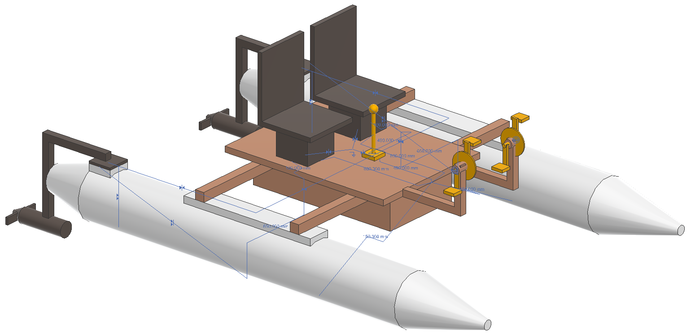

  

# NXonaut

Let Claude work next to you in **Siemens NX**: parts, sketches, assemblies with
constraints, measurements, drawings and STEP export.

NXonaut is built first for **Claude** (Claude Desktop and Claude Code). Other MCP
clients such as Codex or Cursor work too: see the
[manual install](https://michaelhaldimann-png.github.io/NXonaut/install/#manual-install).

**Documentation: [michaelhaldimann-png.github.io/NXonaut](https://michaelhaldimann-png.github.io/NXonaut/)**

## Install and start (Claude Desktop, Windows)

1. Download `nxonaut-<version>.mcpb` from the
   [latest release](https://github.com/MichaelHaldimann-png/NXonaut/releases/latest).
2. Double-click the file and click **Install** in Claude Desktop.
3. Restart Claude Desktop.
4. Start NX. If the small **NX MCP** panel does not appear by itself, press **Alt+F8**,
   type the full path `C:\Users\<you>\NX_MCP_WORKSPACE\Start NXonaut.py` and click
   **Run**.
5. Ask Claude something, for example:

   > *Create a 100 x 60 x 10 mm plate with a 10 mm hole, put a 30 mm pin in it as an
   > assembly and show me a picture.*

Claude only changes parts it made, or parts you allow on the panel, and only uses files
in the workspace folder.

**Claude Code:** `/plugin install nxonaut --marketplace MichaelHaldimann-png/nxonaut`
(needs [uv](https://docs.astral.sh/uv/)), then steps 4 and 5.

## Example: a red road bike frame

One sentence to Claude, in German:

> *Modelliere einen schnellen roten Fahrradrahmen mit Schweisszeichnung.*
> (Model a fast red bike frame with a welding drawing.)

Claude built a parametric diamond frame in NX 2512: tube centrelines in a fully
constrained sketch driven by expressions (seat and head angle, reach, stack, tube sizes),
11 separate steel tubes and dropouts with coped (fishmouth) ends, checked for 14 weld
seams with no overlap. Then an A2 welding drawing with three views, main dimensions,
ISO 2553 fillet weld symbols, a parts list and a weld table, exported to PDF.
From the prompt to the finished PDF took about 11 minutes: some 8 for the model and
3 for the drawing.

  
  
   Modelled and drawn by NXonaut with Claude in NX 2512, in about 11 minutes.

## Example: a pedal boat assembly

Another sentence, again in German:

> *Baue eine Baugruppe eines Tretboots mit zwei Schwimmern, sauber mit Constraints.*
> (Build an assembly of a pedal boat with two floats, properly constrained.)

Claude modelled seven new parts in NX 2512 (float, frame with deck and cross beams,
seat, pedal crank, folding motor with propeller, steering stick) and placed ten
components in an assembly with 24 constraints (touch, align, distance, concentric),
all solved. The cranks are left free to turn in their bearings. Main sizes are
expressions: change the half beam from 1100 to 1200 mm and both floats and motors move
out with it. From the prompt to the finished assembly took about 11 minutes.

  
   Modelled by NXonaut in ~11 min

## Bugs and feedback

I build NXonaut alongside my own work in NX, and I can only test it on the NX I have.
So if something breaks on your setup, I want to hear about it.

- Open an [issue](https://github.com/MichaelHaldimann-png/NXonaut/issues/new/choose)
  and tell me what you tried and what NX did. A short note is fine.
- If you like, turn on anonymous error reports (`python -m nx_mcp.error_reports ask`).
  They are off until you say yes, and they never contain part names, paths or geometry.
  [What gets sent](https://michaelhaldimann-png.github.io/NXonaut/error-reports/).

Reports and issues end up on the list for the weekly build. Once a fix is in, it ships
with the next release, so what you report really does come back to you fixed.

Ideas, questions and "this would help me" are just as welcome as bug reports.

## Credits

NXonaut builds on [skyf0l/siemens-nx-mcp](https://github.com/skyf0l/siemens-nx-mcp),
[DreamEnding/NX_MCP](https://github.com/DreamEnding/NX_MCP),
[xuio/NX_MCP](https://github.com/xuio/NX_MCP) and
[LT60/nx-agent](https://github.com/LT60/nx-agent) (all MIT). It is a weekly updated
version, based on the NX MCP projects where the licence allows it.
[What comes from where](https://michaelhaldimann-png.github.io/NXonaut/credits/).

MIT licence, see [LICENSE](LICENSE) and [licenses/](licenses/). **Not affiliated with or
endorsed by Siemens**; Siemens, NX and NXOpen are trademarks of Siemens. You need your
own licensed NX.
