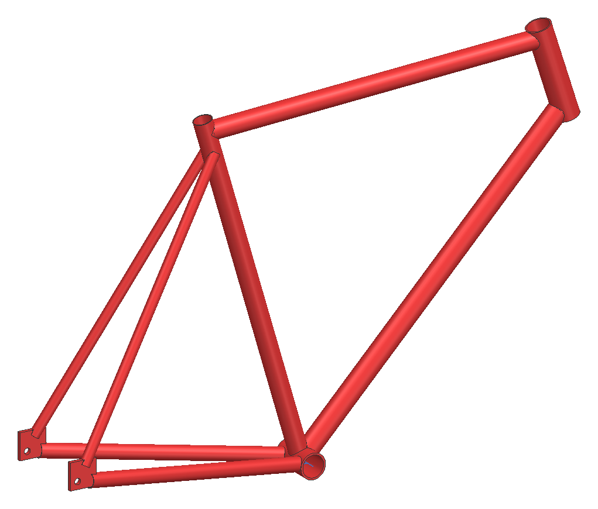
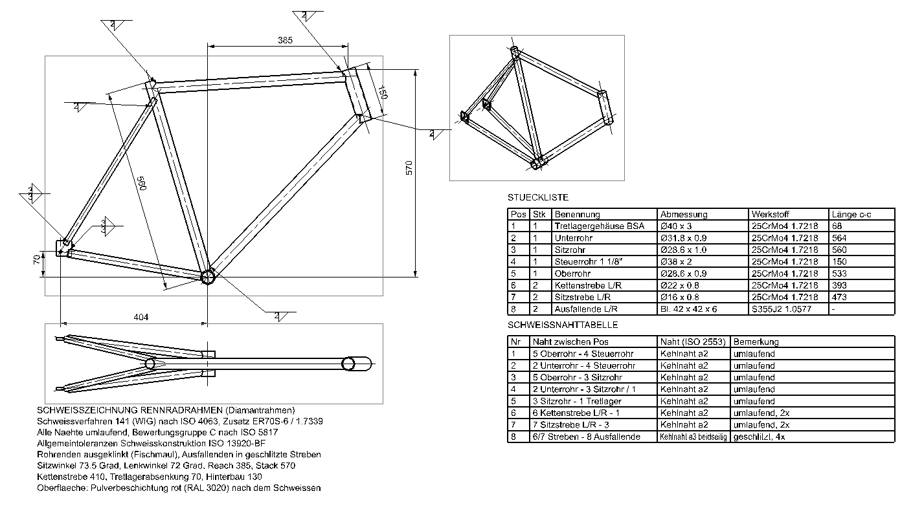

## Install and start in 5 steps

1. Download `nxonaut-<version>.mcpb` from the
   [latest release](https://github.com/MichaelHaldimann-png/NXonaut/releases/latest).
2. Double-click the file and click **Install** in Claude Desktop.
3. Restart Claude Desktop.
4. Start NX. If the small **NX MCP** panel does not appear by itself, press **Alt+F8**,
   type the full path `C:\Users\<you>\NX_MCP_WORKSPACE\Start NXonaut.py` and click
   **Run**.
5. Ask Claude something, for example:

   > *Create a 100 x 60 x 10 mm plate with a 10 mm hole, put a 30 mm pin in it as an
   > assembly and show me a picture.*

Claude only changes parts it made, or parts you allow on the panel, and only uses files
in the workspace folder.

**Claude Code:** `/plugin install nxonaut --marketplace MichaelHaldimann-png/nxonaut`
(needs [uv](https://docs.astral.sh/uv/)), then steps 4 and 5.
Other MCP clients and more options: [Install](install.md).

## Example: a red road bike frame

One sentence to Claude, in German:

> *Modelliere einen schnellen roten Fahrradrahmen mit Schweisszeichnung.*
> (Model a fast red bike frame with a welding drawing.)

Claude built a parametric diamond frame in NX 2512: tube centrelines in a fully
constrained sketch driven by expressions (seat and head angle, reach, stack, tube sizes),
11 separate steel tubes and dropouts with coped (fishmouth) ends, checked for 14 weld
seams with no overlap. Then an A2 welding drawing with three views, main dimensions,
ISO 2553 fillet weld symbols, a parts list and a weld table, exported to PDF.

  
  

## About NXonaut

Community MCP server for Siemens NX, built first for Claude (Claude Desktop and Claude
Code) and open to any MCP client (Codex, Cursor and others): let an AI assistant model, inspect and draw in NX on Windows: parts, sketches, curves, features,
synchronous edits and body repair, freeform surfaces, sheet metal, assemblies
(arrangements, clearance sets, weight and centre of gravity), motion, topology
optimization and strength checks, measurements and surface analysis, drawings, part
families, Knowledge Fusion rules, render materials and decals, and exports (STEP, PDF,
DXF/DWG and more). You keep working in NX while the agent works next to you.

> NXonaut is a community project. It is **not affiliated with or endorsed by Siemens**
> and contains no Siemens software; Siemens, NX and NXOpen are trademarks of Siemens.
> You need your own licensed NX installation.

NXonaut builds on [skyf0l/siemens-nx-mcp](https://github.com/skyf0l/siemens-nx-mcp),
which grew out of [DreamEnding/NX_MCP](https://github.com/DreamEnding/NX_MCP), and adds
file snapshots with rollback from [LT60/nx-agent](https://github.com/LT60/nx-agent).
See [Credits](credits.md).

**A weekly updated version, based on the different NX MCP projects where the licence
allows it.** Once a week, new open-source NX MCP work on GitHub is reviewed; what is
useful and under a compatible licence (MIT, BSD, Apache 2.0) is merged in, with its
licence kept in [licenses/](https://github.com/MichaelHaldimann-png/NXonaut/blob/master/licenses/) and its authors added to the credits.

The Python package and program keep the upstream name
`nx-mcp` so that upstream changes can still be merged.

Tested on NX 2406; NX 2412 to 2606 are expected to work (see
[Supported NX versions](nx-versions.md)). The full list of tools is in
[Tools](tools.md).

